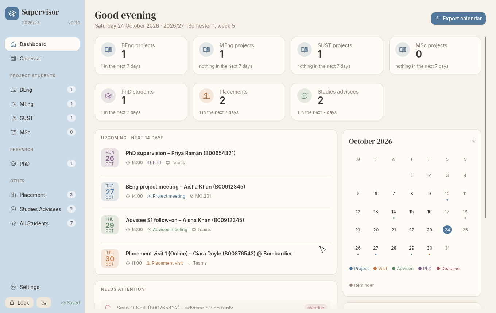
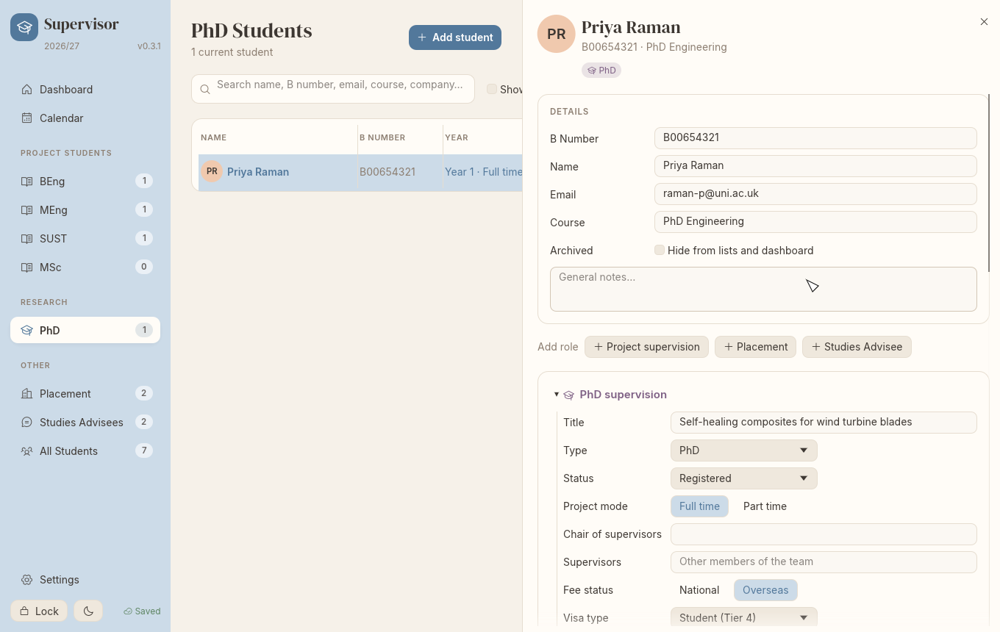

# Supervisor

A desktop app for keeping track of the students you supervise: final-year and MSc projects, PhD students, placement visits and studies advisees. It runs on Linux, Windows and macOS, and keeps everything in one encrypted file on your computer.



## What it does

- **Dashboard**: what's coming up, and what needs chasing (no reply, overdue coursework, PhD deadlines, visas about to end).
- **Lists** for each group of students. Click a student to open their details on the right.
- **Meetings**, one-off or repeating, online (Teams) or in a room. Mark each week as held, cancelled or moved.
- **Coursework deadlines** are worked out from the teaching weeks you set in Settings.
- **PhD students**: assessments, annual reports, submission and viva. Type in the deadlines from the university system and the app reminds you in time.
- **Placement visits**: requests, replies and whether the line manager is coming.
- **Calendar** as a list or a month grid. Export any items to an `.ics` file for Outlook or Google Calendar, or save an invite file for one meeting to send to the student.



## Your data

- Everything is in **one encrypted file**, protected by your password. It saves automatically and keeps a backup of the file as it was when you unlocked it (`.bak`).
- **Save** (click *Saved* at the bottom of the sidebar, or `Ctrl+S`) saves straight away without locking. The backup then keeps that version, so you can go back to it if later changes go wrong.
- **There is no password recovery.** Remember the password and keep a backup of the file.
- New passwords need **at least 12 characters**. A short sentence you'll remember works well.
- Default location:
  - Linux: `~/.local/share/supervisor/data.svt`
  - Windows: `%APPDATA%\Supervisor\data\data.svt`
  - macOS: `~/Library/Application Support/Supervisor/data.svt`

  You can open or create a file somewhere else (e.g. a synced folder) from the unlock screen.
- **Lock** (bottom of the sidebar, or `Ctrl+L`) saves your changes and closes your data; you need your password to open it again. Supervisor also locks by itself after **10 minutes** without use. Change this in Settings › Security.
- If saving fails (for example, a network drive is disconnected), Supervisor tells you and won't lock or close until your changes are saved, unless you choose to discard them.
- A data file can be open in only one Supervisor window at a time. If it is changed somewhere else while you have it open (e.g. on another computer sharing the file), Supervisor asks before replacing that version, and keeps it as the `.bak`.
- Exported `.ics` files are **not** encrypted.

## Key file (optional)

If your data file is in a synced or shared folder (OneDrive, Dropbox, a network drive), you can protect it with a **key file** as well as your password. The key file is a small file kept on each computer you use, never next to the data file. Without it, a copy of the data file can't be opened, even by someone who guesses your password.

**Turn it on:** in Settings › Key file, type your password and click **Add key file…**. Supervisor saves the key file on this computer and asks you to save a backup copy before turning it on. Keep that backup somewhere safe: a USB stick, or as an attachment in a password manager such as KeePassXC or Bitwarden.

**On each other computer:** open the data file as usual. Supervisor says the key file is missing; click **Import key file…** and choose your backup copy. You only do this once per computer.

The key file is kept here:

| Computer | Key file | To open the folder |
| --- | --- | --- |
| Linux | `~/.config/supervisor/key.bin` | In your file manager, press `Ctrl+H` to show hidden folders |
| Windows | `%APPDATA%\Supervisor\config\key.bin` | Press `Win+R`, paste `%APPDATA%\Supervisor\config`, press Enter |
| macOS | `~/Library/Preferences/Supervisor/key.bin` | In Finder, choose Go › Go to Folder… (`Shift+Cmd+G`) and paste `~/Library/Preferences/Supervisor` |

Instead of using **Import key file…**, you can copy your backup into that folder yourself (create the folder if it isn't there) and rename it `key.bin`. On Linux, also run `chmod 600 ~/.config/supervisor/key.bin`.

- **Never keep the key file or its backup in the same folder as the data file.** If they're together, the key file protects nothing.
- **If you lose every copy of the key file, your data can't be opened**, even with the right password.
- Copies of the data file made before you turned the key file on (older backups, or your sync service's version history) still open with the password alone.
- To turn it off, go to Settings › Key file and click **Remove key file**.

## Getting started

1. Set a password on first launch.
2. In **Settings**, enter the academic year and the date week 1 starts in each semester.
3. Add students with **Add student** (`Ctrl+N`) and fill in the rest from their details panel.

## Install

You need [Rust](https://rustup.rs) 1.95 or newer on every platform.

### Linux

On Debian/Ubuntu, first install `libxkbcommon-dev libwayland-dev`. Then:

```sh
./install.sh                       # build and install for your user
./install.sh --path=~/Documents/   # ...and keep the data file in ~/Documents
./install.sh --uninstall           # remove the app (your data is kept)
```

This adds `supervisor` to `~/.local/bin` and puts it in your app launcher with its icon.

### Windows

1. Install Rust from [rustup.rs](https://rustup.rs). When it asks, install the Visual Studio Build Tools with **Desktop development with C++**.
2. Build:

   ```powershell
   cargo build --release
   ```

3. Copy `target\release\supervisor.exe` somewhere permanent, e.g. `%LOCALAPPDATA%\Programs\Supervisor\`. Right-click it to pin it to Start or make a desktop shortcut.

To update, build again and replace the exe. Your data is stored separately, so it isn't affected.

To run it on another PC, only the exe is needed. If Windows warns *"Windows protected your PC"*, click *More info* → *Run anyway*. If it says *VCRUNTIME140.dll was not found*, install the [Visual C++ Redistributable](https://aka.ms/vc14/vc_redist.x64.exe).

### macOS

1. Install the developer tools with `xcode-select --install`, and Rust from [rustup.rs](https://rustup.rs).
2. Build and install:

   ```sh
   cargo build --release
   sudo cp target/release/supervisor /usr/local/bin/
   ```

3. Run `supervisor` from the Terminal.

## Development

```sh
cargo test                                         # unit tests + headless UI test
SUPERVISOR_SHOTS=/some/dir cargo test end_to_end   # also save screenshots
```

Pushing a `v*` tag runs `cargo audit` and the tests, then builds Linux, Windows and macOS binaries on GitHub Actions, plus a `SHA256SUMS.txt` with their checksums.
