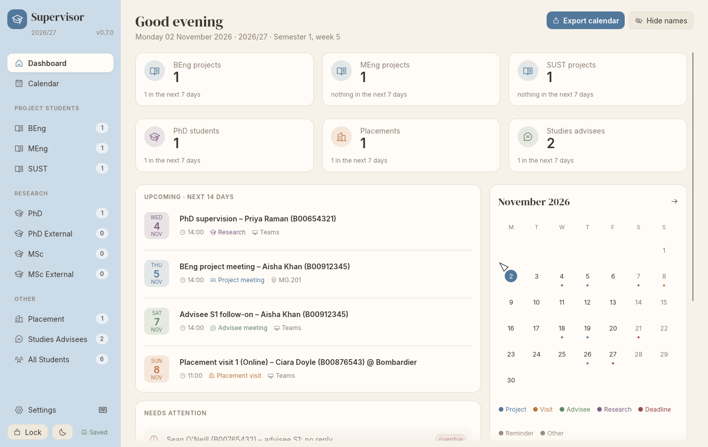
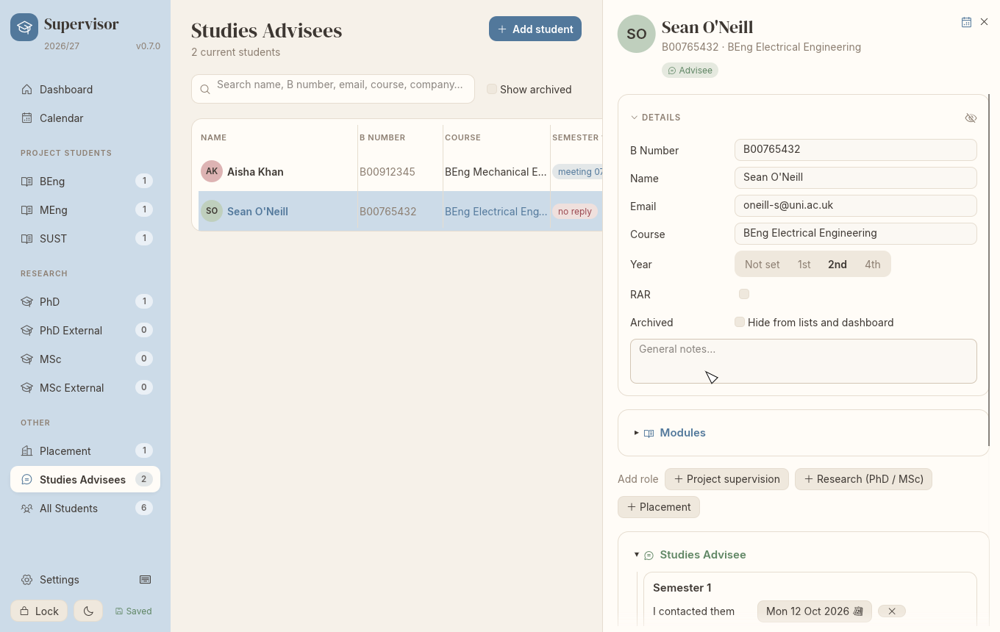
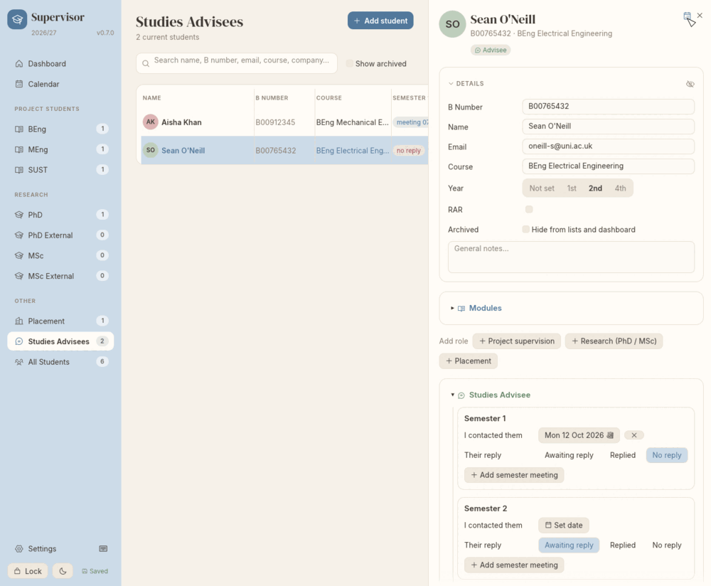
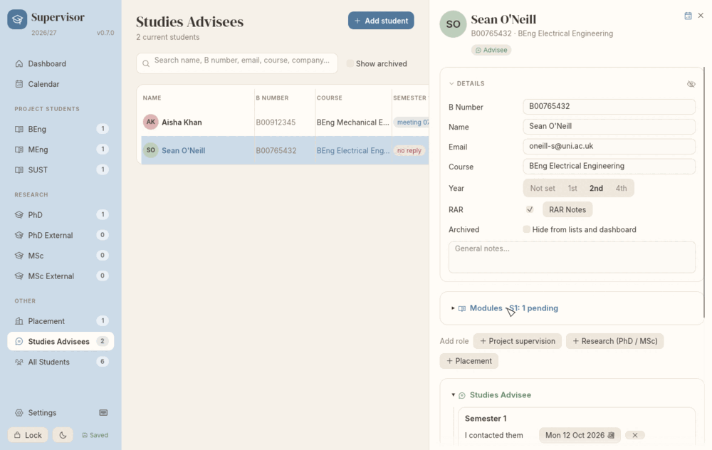
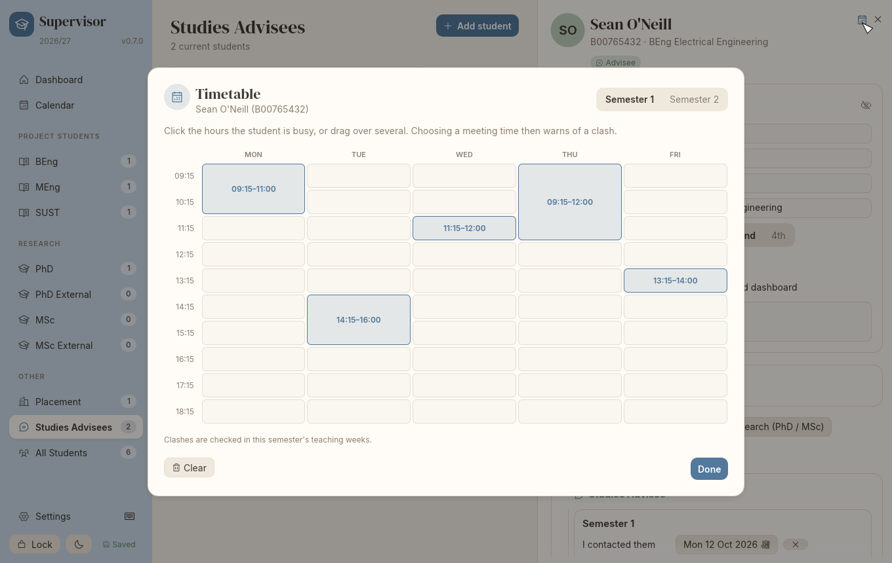
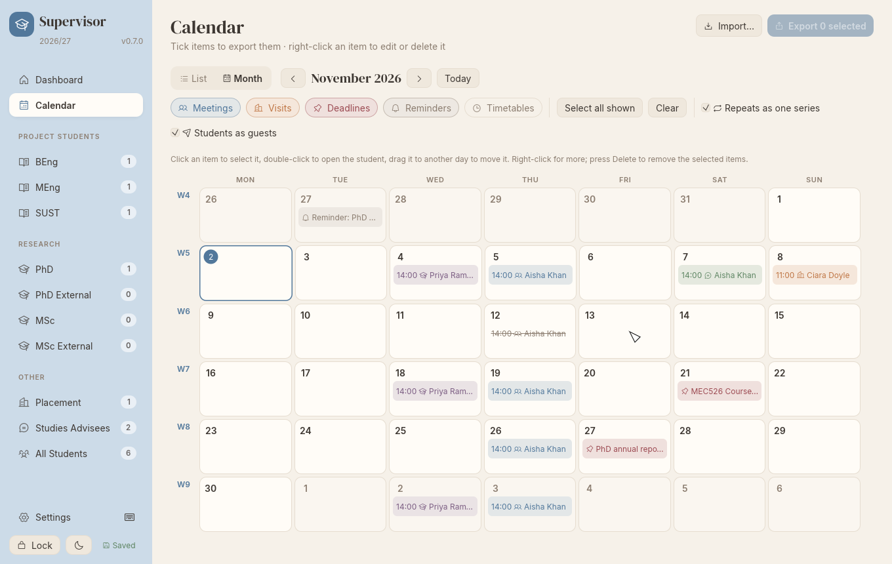

# Supervisor

Supervisor is a desktop application for the administration of student supervision. It covers final-year projects, research students (PhD and MSc), placement visits and studies advisees. It runs on Linux, Windows and macOS, and it stores all records in a single encrypted file on the user's computer. The application was developed with the assistance of Claude Opus 5.5.



## Features

- **Dashboard:** upcoming events and items that require attention, such as unanswered contact, overdue coursework, research deadlines and the end of visas or grants.
- **Student lists:** one list for each group of students, with the details of the selected student in a side panel.
- **Project supervision:** second markers, coursework deadlines derived from the teaching weeks, and marks from each marker with a suggested agreed mark. Separate fields apply to SUST students.
- **Research students:** four lists (PhD, PhD External, MSc and MSc External) with assessments, annual reports, submission, viva and reminders. External students have their own list of deadlines.
- **Brazilian programmes:** academic and professional levels, funding bodies, standard stages, the defence committee and suggested deadlines.
- **Placement visits:** requests, replies and the attendance of the line manager.
- **Studies advisees:** contact, replies and meetings for each semester, together with the year of study (1st, 2nd or 4th).
- **Modules:** a card, collapsed by default, for local advisees and project students. For each semester it records whether modules are pending from the previous semester. For each pending module it records the code, the name, the failed component (CW, EX or CW+EX) and the marks. In Semester 2 it also records whether the module was discussed with an advisee. The number of pending modules determines whether the student needs to talk to their advisor, the course director or the Head of School. These thresholds are set in Settings.
- **Reasonable adjustments:** a RAR option for local students, with notes that open only after password confirmation.
- **Meetings:** one-off or repeating, online or in a room, with the status and notes of each week.
- **Student timetables:** the hours in which a student is busy in each semester, with a warning when a meeting clashes.
- **Calendar:** list and month views, with editing, postponing and moving of items, import and export of `.ics` files, invite files and Google Calendar links.
- **Privacy:** names, student numbers and marks can be hidden on screen. The registration numbers of external students are hidden until revealed, and they are never placed in calendar or invite files.



Recording a pending module:



Opening the RAR notes of a student:



Entering a student timetable:



The calendar, month view:



## Data safety

Supervisor holds personal data about students, so the protection of the data file and the recovery of its contents depend on the measures below.

### Storage and encryption

- All records are stored in **one encrypted file**, protected by a password.
- New passwords require **at least 12 characters**. A short memorable sentence is suitable.
- **The password cannot be recovered.** The password must be retained, and a backup of the file must be kept.
- The default location of the file is as follows:
  - Linux: `~/.local/share/supervisor/data.svt`
  - Windows: `%APPDATA%\Supervisor\data\data.svt`
  - macOS: `~/Library/Application Support/Supervisor/data.svt`
- A file in another location, such as a synced folder, can be opened or created from the unlock screen.
- Exported `.ics` files are **not** encrypted.

### Saving and locking

- Changes are saved automatically. A backup of the file as it was at unlocking is kept with the extension `.bak`.
- **Save** (_Saved_ at the bottom of the sidebar, or `Ctrl+S`) saves immediately without locking. The backup then holds that version, which allows a return to it if later changes prove incorrect.
- **Lock** (bottom of the sidebar, or `Ctrl+L`) saves all changes and closes the data. The password is required to open it again. The application also locks after **10 minutes** of inactivity. This period can be changed in Settings › Security.
- If saving fails, for example because a network drive is disconnected, the application reports the failure. It does not lock or close until the changes are saved, unless the user chooses to discard them.
- A data file can be open in only one Supervisor window at a time. If the file is changed elsewhere while open, for example on another computer sharing the file, the application asks before replacing that version and keeps it as the `.bak`.

### Sensitive records

- RAR notes are stored in the encrypted file. The password is requested each time they are opened, and the notes are never placed in calendar or invite files.
- The marks of pending modules are shown as dots until revealed.

### Backup copy (optional)

A backup copy is enabled in Settings › Backup copy with **Choose folder…**. The folder should be on another drive, a USB stick or a synced folder, and not where the data file is kept. Each save then replaces a copy of the data file in that folder, with a name such as `data-backup-1a2b3c4d.svt`, so that the failure of one disk does not affect both files.

- The copy is **encrypted to the same standard as the data file** and opens with the same password, and with the same key file if one is in use.
- To use the copy, select **Open another file…** on the unlock screen and choose the copy. The application then continues from that file.
- The copy always holds the latest save. Earlier versions are available only from the `.bak` next to the data file.
- If the folder cannot be reached, the data file is still saved as usual. A message reports the problem, and **Saved** at the bottom of the sidebar shows a warning. The copy resumes on the next save, or with **Back up now**.
- A change of password also updates the copy, provided that the folder can be reached.
- The folder is remembered **on the current computer only**, so it must be chosen on each computer. Disabling the copy or changing the folder leaves the old copy in place, and it must be deleted manually if it is no longer needed.
- **The backup of the key file must not be kept in the same folder.** Together, they would allow anyone with access to that folder to open the copy with the password alone.

### Key file (optional)

A data file in a synced or shared folder (OneDrive, Dropbox or a network drive) can be protected by a **key file** in addition to the password. The key file is a small file kept on each computer in use, and never next to the data file. Without it, a copy of the data file cannot be opened, even with the correct password.

**Activation:** in Settings › Key file, enter the password and select **Add key file…**. The application saves the key file on the computer and asks for a backup copy to be saved before activation. The backup should be kept in a safe place, such as a USB stick or an attachment in a password manager (KeePassXC or Bitwarden).

**Other computers:** open the data file as usual. The application reports that the key file is missing. Select **Import key file…** and choose the backup copy. This step is required once on each computer.

The key file is kept in the following locations:

| Computer | Key file                                   | To open the folder                                                                                |
| -------- | ------------------------------------------ | ------------------------------------------------------------------------------------------------- |
| Linux    | `~/.config/supervisor/key.bin`             | In the file manager, press `Ctrl+H` to show hidden folders                                        |
| Windows  | `%APPDATA%\Supervisor\config\key.bin`      | Press `Win+R`, paste `%APPDATA%\Supervisor\config`, press Enter                                   |
| macOS    | `~/Library/Preferences/Supervisor/key.bin` | In Finder, choose Go › Go to Folder… (`Shift+Cmd+G`) and paste `~/Library/Preferences/Supervisor` |

As an alternative to **Import key file…**, the backup can be copied into that folder manually (the folder is created if absent) and renamed `key.bin`. On Linux, `chmod 600 ~/.config/supervisor/key.bin` is also required.

- **The key file and its backup must never be kept in the same folder as the data file.** In that case the key file provides no protection.
- **If every copy of the key file is lost, the data cannot be opened**, even with the correct password.
- Copies of the data file made before activation, such as older backups or the version history of a sync service, still open with the password alone.
- The key file is removed in Settings › Key file with **Remove key file**.

## Getting started

1. Set a password on first launch.
2. In **Settings**, enter the academic year and the date on which week 1 starts in each semester.
3. Add students with **Add student** (`Ctrl+N`) and complete the remaining fields in the details panel.

The keyboard button next to **Settings** (or `F1`) lists the keyboard shortcuts.

## Installation

[Rust](https://rustup.rs) 1.95 or newer is required on every platform.

### Linux

On Debian or Ubuntu, first install `libxkbcommon-dev` and `libwayland-dev`. Then run the following:

```sh
./install.sh                       # build and install for the current user
./install.sh --path=~/Documents/   # also keep the data file in ~/Documents
./install.sh --uninstall           # remove the application and keep the data
```

The script adds `supervisor` to `~/.local/bin` and places it in the application launcher with its icon.

### Windows

1. Install Rust from [rustup.rs](https://rustup.rs). When prompted, install the Visual Studio Build Tools with **Desktop development with C++**.
2. Build the application:

   ```powershell
   cargo build --release
   ```

3. Copy `target\release\supervisor.exe` to a permanent location, such as `%LOCALAPPDATA%\Programs\Supervisor\`. It can be pinned to Start or given a desktop shortcut from its context menu.

To update, build again and replace the executable. The data is stored separately and is not affected.

Only the executable is needed on another PC. If Windows displays _"Windows protected your PC"_, select _More info_ and then _Run anyway_. If it reports that _VCRUNTIME140.dll was not found_, install the [Visual C++ Redistributable](https://aka.ms/vc14/vc_redist.x64.exe).

### macOS

1. Install the developer tools with `xcode-select --install`, and Rust from [rustup.rs](https://rustup.rs).
2. Build and install the application:

   ```sh
   cargo build --release
   sudo cp target/release/supervisor /usr/local/bin/
   ```

3. Run `supervisor` from the Terminal.
